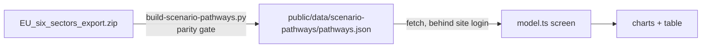

# M·55 Scenarios — EU pathways under the 2040 screening

Main module, pinned to the top bar next to the
[Reference Manager](references.md) and the [Project Workspace](project-workspace.md).
Route: `/scenario-pathways`.

!!! warning "Internal — embargoed data · AI-compiled — pending Secretariat verification"
    The pathway data contain Scenario Compass v2.0 results under embargo. They
    are served only behind the site login and must not be copied to external
    services or public repositories. The screening port and the charts are
    AI-compiled; with the default settings they reproduce the EEA export
    exactly (see *Parity* below), any other setting is exploratory.

## User story

A Secretariat analyst wants to know how the six sector pictures of the 2040
advice change if a screening criterion is set differently: a looser 2050
net-GHG tolerance, a narrower 2040 window, a stricter bioenergy limit. The
module loads the 1,328 pathways of the EEA export, applies the five screening
steps with every threshold on a control, and redraws all chart types of the
presented deck for the pathways that are left.

## Controls

| Step | Control | Export default |
|---|---|---|
| 0 · Source databases | pills per source pool | all 16 |
| 1 · 2030 cut vs 1990 | toggle, presets 50 / 55 / 60 %, slider | off (potential likely setting: ≥ 55 %) |
| 2 · EU net GHG in 2050 | presets ≤ 0 / ≤ 150 / ≤ 300 Mt plus a slider (−300 to 600 Mt) | ≤ 150 Mt |
| 3 · 2040 cut vs 1990 | presets plus a two-handle timeline (70–100 %, right handle at 100 = open) | 85–95 % |
| 4 · ESABCC filter (Table 5) | six threshold sliders | 500 Mt capture, 20 EJ bioenergy, 8,600 Mt world storage, 240 EJ world bioenergy, 1.89 EJ hydrogen 2030, 20 % final-energy decline |
| 5 · Risk levels (Table 6) | three threshold sliders | 425 Mt capture, 9 EJ bioenergy, 400 Mt land sink |
| 4–5 · Common rules | margin on all limits; "missing values count as passed" | 0 %; on |

Each step can be switched off. Every setting lives in the URL, so a view can
be shared as a link.

## 2030 rule and the potential likely setting

Step 1 (off by default) keeps pathways whose EU net GHG cut 2030 vs 1990 is
at least the chosen share (default 55 %, rounded to one decimal; missing values
pass). The export has no 2030 cut; the build script derives it from the
export's 2040 cut and the reported 2030 and 2040 net GHG, which reproduces the
EEA deck "EU screening settings: potential likely setting" exactly. The panel
button **◆ Potential likely setting** sets ≥ 55 % by 2030, 85–90 % by 2040 and
≤ 300 Mt in 2050 (40 pathways); a badge confirms the PDF's funnel on every
load.

## Slides

**Make slides** renders that deck for the current setting: the tolerance
table, the three rule strips by model family, the funnel with the ESABCC
limits, and one slide per selected sector with trajectory, 2050 annotation
and lever tiles. **Present** opens full screen (arrow keys, Esc); **Print /
save as PDF** prints one 16:9 slide per page.

## Scaling to the historic inventory

By default every emission result is scaled so that each pathway's 2020
value equals the EEA inventory for 2020 (base year 2020, the year the export
already harmonises industry to). The panel offers three methods:

| Method | Rule | Note |
|---|---|---|
| Ratio (default) | v′(y) = v(y) × inv₂₀₂₀ / v₂₀₂₀ | Falls back to offset where model and inventory 2020 differ in sign or the factor lies outside 0.25–4 (most ecosystem pathways) |
| Offset | v′(y) = v(y) + (inv₂₀₂₀ − v₂₀₂₀) | Pushes mobility and buildings well below zero by 2050 |
| As reported | no scaling | The deck |

It applies to EU net GHG (target: inventory net total 2020) and the six
sectors' emissions, including the emissions columns of the lever charts.
Lever indicators (TWh, EJ, Mha) stay as reported. The correction is held
constant to 2050. Screening step 1 uses the reported 2050 net GHG unless
"Use scaled 2050 net GHG in step 1" is switched on (advice setting: 75
instead of 64 pathways). The CSV carries reported and scaled columns side
by side.

## Views and charts

- **Screen** — funnel of pathways per step; median EU net GHG at each step with
  the 1990–2024 inventory; median trajectory per sector; a 2050 summary table.
- **Inspect sectors** — per sector: headline tiles; filtered pathways (median,
  25–75 %, 5–95 %, inventory bars, orange 2050 range across the six settings);
  all pathways vs the net-GHG subset with the 2020 model median; the six
  settings as small multiples; the lever chart (2040 strip plot plus lever
  ranges per setting).
- **Compare settings** — 2050 median per sector and setting (dot plot, orange
  ring on the setting of the 2040 advice), pathway counts per setting, the
  levers table and the method table.
- **Browse pathways** — every pathway with its screening outcome and the tests
  it failed; sortable, searchable, CSV download of the current selection.

The "six settings" are the deck's ({≤ 0, ≤ 150 Mt} × {85–90 %, 85–95 %, ≥ 85 %});
the user's source, filter, risk and margin choices are carried over to them.

## Code surface

| File | Role |
|---|---|
| [`scripts/build-scenario-pathways.py`](https://github.com/EUClimateAdvisoryBoard/ESABCCMethodHub/blob/main/scripts/build-scenario-pathways.py) | Reads `EU_six_sectors_export.zip`, checks parity, writes the JSON and copies the deck |
| [`src/lib/scenario-pathways/model.ts`](https://github.com/EUClimateAdvisoryBoard/ESABCCMethodHub/blob/main/src/lib/scenario-pathways/model.ts) | Screening port, sector definitions, numpy-compatible percentiles |
| [`src/components/scenario-pathways/ScenarioPathways.tsx`](https://github.com/EUClimateAdvisoryBoard/ESABCCMethodHub/blob/main/src/components/scenario-pathways/ScenarioPathways.tsx) | Page, filter panel, views |
| [`src/components/scenario-pathways/charts.tsx`](https://github.com/EUClimateAdvisoryBoard/ESABCCMethodHub/blob/main/src/components/scenario-pathways/charts.tsx) | SVG charts in the deck's palette |
| [`src/components/scenario-pathways/slides.tsx`](https://github.com/EUClimateAdvisoryBoard/ESABCCMethodHub/blob/main/src/components/scenario-pathways/slides.tsx) | Slide view, presenter, print |
| [`src/components/scenario-pathways/controls.tsx`](https://github.com/EUClimateAdvisoryBoard/ESABCCMethodHub/blob/main/src/components/scenario-pathways/controls.tsx) | Sliders, two-handle timeline, toggles |
| [`src/app/scenario-pathways/page.tsx`](https://github.com/EUClimateAdvisoryBoard/ESABCCMethodHub/blob/main/src/app/scenario-pathways/page.tsx) | Route shell |

## Data flow

The JSON sits under `public/data/`, which the site-auth middleware gates; it
is fetched at runtime and never bundled into the ungated `_next/static`
JavaScript. A login redirect (HTML instead of JSON) or a truncated file is
reported as an error, never shown as an empty result.

## Parity

The screening follows the export's `scripts/variants.py`: thresholds `TH`,
windows (whole-percent rounding: lower bound − 0.05, upper bound + 0.5),
margin factor 1 + m, missing values pass, JRC pathways without a 2050 value
fall back on the net-zero flag. The build script and the page both re-run the
export's twelve stage columns (`nz{0|150}|{window}|m{0|10}`) for all 1,328
pathways and require 15,936 of 15,936 codes to match; the page shows the
result as a badge. Percentiles use linear interpolation (numpy's default), so
the medians and bands equal the deck's.

## Known limits

- The scaling uses one base year (2020, a COVID year) and no convergence;
  it is a presentation choice, not a re-run of the models.
- Threshold units are inferred from the variable definitions and data ranges;
  the values themselves are the export's.
- Rebuilding needs the zip at the repository root:
  `python3 -I scripts/build-scenario-pathways.py`.
