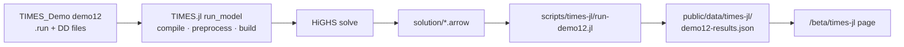

# M · 56 — TIMES.jl Demo Runner

!!! tip "Status"
    Beta · route `/beta/times-jl` · source [`beta/modules/times-jl/`](https://github.com/EUClimateAdvisoryBoard/ESABCCMethodHub/tree/main/beta/modules/times-jl)

!!! warning "AI-compiled — pending Secretariat verification"
    The numbers this module shows are solver output of **demo12**, the stylised
    two-region teaching model that ships with TIMES. Its regions (REG1, REG2)
    represent no real country, so nothing on the page is an EU projection.
    TIMES.jl is pre-release and is not an IEA-ETSAP product.

TIMES is the IEA-ETSAP energy-system model generator behind many of the models
that inform EU climate policy, JRC-EU-TIMES among them. It is written in GAMS
and is normally solved with a commercial solver such as CPLEX.
[TIMES.jl](https://github.com/esma-ie/TIMESjl) (ESMA Ltd, GPL-3.0) is an
independent translation into Julia and JuMP. It reads a TIMES model from its
own `.run` and DD files, builds the same linear programme and solves it with the
open-source solver [HiGHS](https://highs.dev).

This module installs TIMES.jl, runs demo12 and shows the result.

## What the page shows

1. **Parity card.** The run's row count, column count and objective against the
   GAMS/CPLEX reference values quoted in the TIMES.jl README. On 2026-11-24
   the run gave the same 3,233 rows and 4,485 columns as GAMS, and an objective
   of 23,960,685.737008 against 23,960,685.737008 (relative difference
   4 × 10⁻¹⁵). Matching sizes and objective are consistent with an identical
   matrix but do not prove it. TIMES.jl's own probes compare every
   coefficient against GAMS, and this module, which has no GAMS, did not repeat
   them.
2. **Results.** Electricity generation by fuel, CO₂ by sector, new power capacity
   and the cost components of the objective. All four are read from the
   solution dump, with a region filter kept in the URL (`?region=REG1`).
3. **Runbook.** The README's workstation recipe, this repository's reproduction
   command, and the two workarounds needed behind the sandbox proxy.
4. **Limits.** What TIMES.jl does not do yet. It writes no report parameters or
   VEDA files (M1.6). Some features are still untranslated (the
   stochastic extension, MACRO, ETL and others); elastic demand's linear form
   is translated at the pinned commit, although the README's Progress text
   still lists it. JRC-EU-TIMES is parity-checked only to
   the end of preprocessing.

## Data flow



The data is reproducible with:

```bash
julia --project=scripts/times-jl -e 'using Pkg; Pkg.instantiate()'
julia --project=scripts/times-jl scripts/times-jl/run-demo12.jl
```

See [`scripts/times-jl/README.md`](https://github.com/EUClimateAdvisoryBoard/ESABCCMethodHub/blob/main/scripts/times-jl/README.md)
for what each JSON key is read from, and for the proxy workarounds.

The run is not part of any scheduled workflow, and the Next.js build does not
need Julia. The page reads the committed JSON and shows an explicit error
state, distinct from an empty one, if the file cannot be loaded.

## Why it is beta

- TIMES.jl has no release yet, its interfaces may change, and its code is
  largely AI-written under human review (its README says so).
- demo12 is a teaching dataset. It has no CO₂ cap or price, while its power mix
  is shaped by a renewable-plant floor and a nuclear capacity limit, so its
  emission path is not a finding.
- A policy-relevant use, such as running JRC-EU-TIMES or a national TIMES
  model, needs model data under a licence that allows it, and is blocked until
  TIMES.jl's parity checks cover that model.

## Deferred backlog

Good ideas deliberately not in this round:

- A CO₂-cap scenario file on top of demo12, to show a carbon price coming out
  of the model.
- A GitHub-runner workflow that re-runs demo12 when the TIMES.jl pin moves.
- Reading TIMES.jl's report parameters once M1.6 lands, instead of raw
  variable levels.
